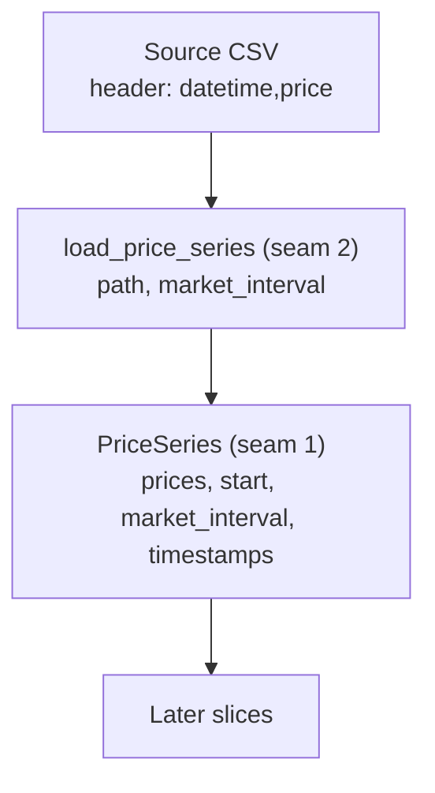

# Slice 1: price-series loading and validation

Status: implemented; the whole-days rule later moved to the loader (slice 1b)

## Goal
- Load a market's prices from CSV into a validated `PriceSeries` on a regular time grid.
- Implements ADR 0002; vocabulary from `CONTEXT.md` (Price series, Market interval).

## Seams
- Seam 1: `PriceSeries`, tested with small in-memory arrays.
- Seam 2: `load_price_series`, tested with small one-day CSV fixtures written in the test.

## Types
- `load_price_series(path: str | Path, market_interval: timedelta) -> PriceSeries`
- `PriceSeries(prices: NDArray[float64], start: datetime, market_interval: timedelta)`
- `PriceSeries.prices`: `NDArray[float64]`.
- `PriceSeries.start`: `datetime`, naive (no timezone), never converted.
- `PriceSeries.market_interval`: `timedelta`, a whole number of seconds, positive, dividing a day.
- `PriceSeries.timestamps`: `NDArray[datetime64]`, regenerated from `start` and `market_interval`.

## Source CSV contract
- Header is exactly `datetime,price`; any other header raises `ValueError`.
- `datetime`: only the first row is read, as `start`; later labels are never parsed.
- `price`: £/MWh as a decimal number; blank or non-numeric raises `ValueError`.
- A header-only file (no rows) raises `ValueError`.
- Comma-separated CSV only; the xlsx is not read.
- `market_interval` is supplied by the caller and is not checked against the file (ADR 0002).
- Local data files are renamed to the mandated headers when the runner first needs them.

## Diagram

## Tests, in order (one red, then green, at a time)
- Fixtures are one whole day (24 hourly or 48 half-hourly rows), because partial days are rejected.
- Expected values are literals, never recomputed from the code under test.
- Every test has a docstring stating the behaviour it covers.

1. Seam 2: known file contents are read correctly (prices as written, in order; `start` from the first label).
2. Seam 2: later labels are ignored entirely: duplicates, float artefacts and unparseable text after row one do not affect the regular grid.
3. Seam 2: time steps other than 1 hour are read correctly (half-hourly fixture).
4. Seam 2: wrong header names raise `ValueError`.
5. Seam 1: a blank price raises `ValueError`.
6. Seam 1: a partial day (47 half-hours) raises `ValueError`.
7. Seam 1: a market interval that does not divide a day (7 h) raises `ValueError`.
8. Seam 1: an empty series raises `ValueError`.
9. Seam 1: a zero or negative market interval raises `ValueError`.
10. Seam 2: a header-only file raises `ValueError`.
11. Seam 2: a blank or non-numeric price in the file raises `ValueError`.
12. Seam 1: a sub-second market interval raises `ValueError`.

## Considered and dropped
- "Whole days are accepted": covered by tests 1 and 3.
- "Prices are read-only": defensive, not required by the brief or an ADR.
- "Timezone-aware `start` is rejected": overkill; the loader never produces one from our files.
- "Cross-check the interval against the first and last labels": accepted weakness, recorded in ADR 0002.

## Known and not addressed
- `PriceSeries` does not coerce `prices` to float64, check it is 1-D, or reject `inf`.

## Out of scope
- Flagging suspect intervals (repeated or zero prices at clock changes): slice 4.
- Combining two series onto a base interval: slice 5.
- Deleting `EnergyMarket` and its test: when `PriceSeries` replaces it.
