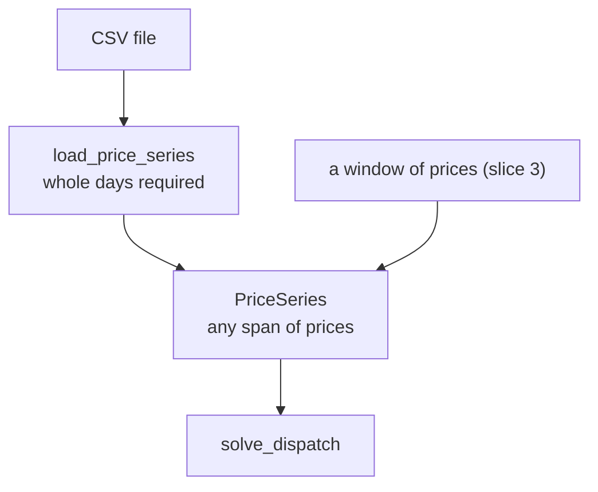

# Slice 1b: whole-days rule moves to the loader

Status: proposed (follow-up to slice 1; do before 2b)

## Goal
- `PriceSeries` accepts any span of prices, so the solver can be tested on short, hand-checkable series and slice 3 can solve 32-hour and shorter-than-a-day windows.
- The whole-days rule stays, but applies to loaded files only (ADR 0002: day-ahead assumption about source data).

## Seams
- Seam 1: `PriceSeries`. Seam 2: `load_price_series`. Types are unchanged.

## What changes
- `PriceSeries` no longer refuses a partial day. It keeps the empty, blank-price, positive-interval, whole-seconds and divides-a-day checks.
- `load_price_series` refuses a file whose row count is not a whole number of days.
- ADR 0002 says the whole-days rule applies when loading.

## Diagram

## Tests, in order (one red, then green, at a time)
- Every test has a docstring stating the behaviour it covers.

1. Seam 1: a series that is not a whole number of days is accepted (4 hourly prices).
2. Seam 2: a file holding a partial day is rejected (47 half-hourly rows raises `ValueError`).
3. Remove the old seam 1 test "a partial day is rejected", replaced by test 2.

## Out of scope
- Cutting windows out of a series: slice 3.
