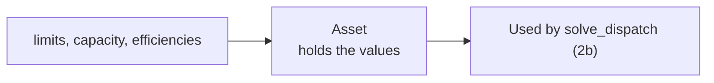

# Slice 2a: Asset

Status: proposed

## Goal
- A description of the battery being dispatched: power limits, capacity, efficiencies.
- No solver and no scipy; the solver arrives in 2b.

## Glossary additions (CONTEXT.md, with this slice)
- **Asset**: the battery being dispatched; its power limits, capacity and efficiencies.

## Seam
- `Asset`, tested through construction only.

## Types
- `Asset(max_charge_power: float, max_discharge_power: float, energy_capacity: float, charge_efficiency: float = 1.0, discharge_efficiency: float = 1.0)`
- Frozen dataclass in `asset.py`; no validation yet.
- Units: MW and MWh. Efficiency is the fraction of energy retained, so 1.0 is lossless.
- Checking that efficiencies are sensible (greater than 0, at most 1) has moved to a later step.
- `asset_data.xlsx` records losses (0.05), not efficiencies; the conversion to 0.95 happens in slice 7.

## Diagram

## Tests, in order (one red, then green, at a time)
- Every test has a docstring stating the behaviour it covers.

1. A valid asset keeps the values it is given, and efficiencies default to 1.0 (lossless).

## Moved to a later step
- Refusing impossible limits and efficiencies.

## Considered and dropped
- Ordering rules between limits (for example charge power versus capacity): not needed by the brief.

## Out of scope
- Reading the asset from a JSON file: moved to a later step. Reading `asset_data.xlsx`: not planned.
- Using the efficiencies: slice 7.
