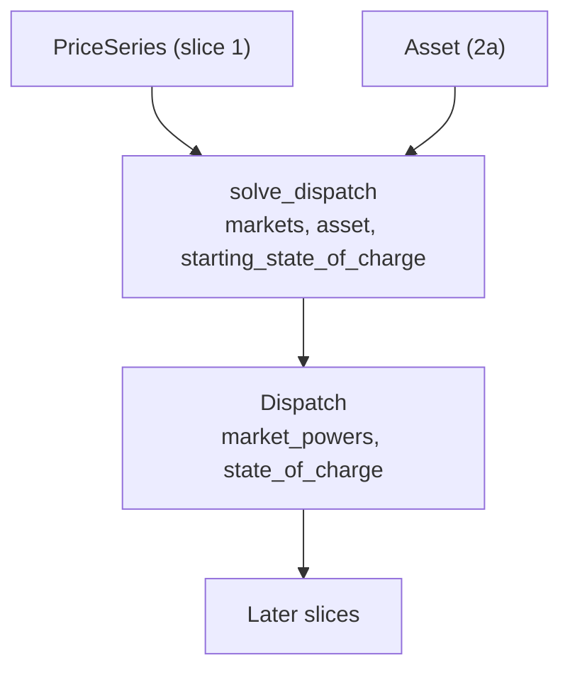

# Slice 2b: dispatch tracer bullet

Status: proposed (needs 2a)

## Goal
- The thinnest end-to-end solve: one market, lossless, whole `PriceSeries` as one window.
- Proves the sparse energy balance, bounds and objective work with scipy, and fixes the public shape (`Dispatch`).
- Built per market (variables indexed by market interval, an expansion matrix per market), so slice 5 adds a market without restructuring.

## Glossary additions (CONTEXT.md, with this slice)
- **State of charge**: energy stored, in MWh, at the end of a base interval.
- **Market power**: net power committed to one market in a market interval; discharge positive.
- **Asset power**: the sum of market power across markets in a base interval.

## Seam
- `solve_dispatch`, tested through its inputs and outputs only; no test reads solver internals.

## Types
- `solve_dispatch(markets: Sequence[PriceSeries], asset: Asset, starting_state_of_charge: float) -> Dispatch`
- `Dispatch.market_powers`: `NDArray[float64]`, shape (markets, market intervals), MW, discharge positive.
- `Dispatch.state_of_charge`: `NDArray[float64]`, one value per base interval, MWh, at the end of the interval.
- Module: `dispatch.py`.

## Formulation (sparse, `scipy.optimize.milp` with no integrality yet)
- Variables per market interval: charge and discharge power, both non-negative.
- One state-of-charge variable per base interval.
- Energy balance: `soc_t - soc_(t-1) - eff_c * charge_t * dt + discharge_t * dt / eff_d = 0`, with `soc_(-1)` = starting state of charge.
- Bounds: charge and discharge within their power limits; state of charge within [0, capacity].
- Objective: maximise `sum(price * dt * (discharge - charge))`.
- Each market gets an expansion matrix onto base intervals; identity for the single market.
- No exclusivity yet (slice 6): charge and discharge can overlap, so tests assert net power only.
- A failed solve raises `RuntimeError`; valid inputs are always feasible, so this path has no test.

## Diagram

## Tests, in order (one red, then green, at a time)
- Fixtures: 24 hourly prices (a whole day), start 2018-01-01, interval 1 h, via a small test helper.
- Expected values are literals, hand-derived: revenue = sum of price x (state of charge before - after). Checked against a scratch LP.
- Every test has a docstring stating the behaviour it covers.

1. Rising prices 1..24, empty battery (1 MW, 1 MWh): charges in the cheapest hour, sells in the dearest; powers [-1, 0 x22, +1], state of charge [1 x23, 0].
2. Exactly one market is accepted: zero or two markets raise `ValueError` until slice 5 (otherwise two markets would allow free cross-market arbitrage before exclusivity).

## Out of scope
- Energy-limit behaviours and starting-charge validation: 2c. Power-limit behaviours: 2d.
- Deleting `optimistion.py`, `EnergyMarket` and their tests: when `runner.py` is rewritten (slice 4), since the runner still imports them.
