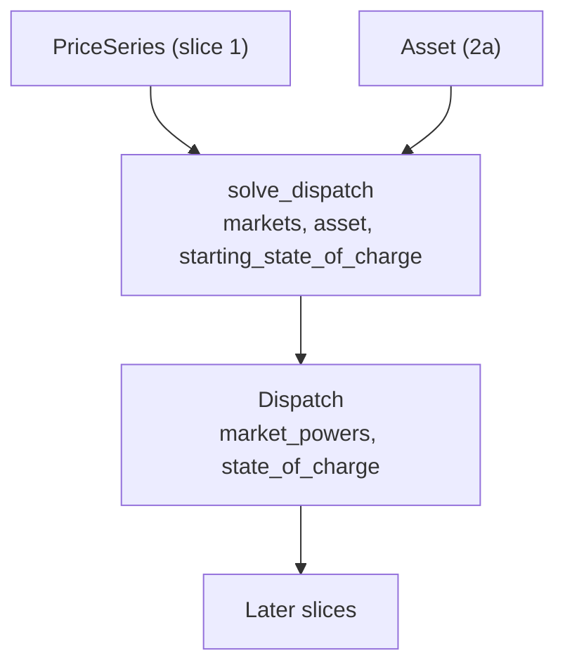

# Slice 2b: dispatch tracer bullet

Status: proposed (2a done; needs 1b)

## Goal
- The thinnest end-to-end solve: one market, lossless, the whole `PriceSeries` as one window.
- Proves the sparse energy balance, state-of-charge bounds and objective work with scipy, and fixes the public shape (`Dispatch`).
- Structured as a list of markets, so slice 5 adds a market by adding blocks, not by restructuring.

## Glossary additions (CONTEXT.md, with this slice)
- **State of charge**: energy stored, in MWh, at the end of a base interval.
- **Market power**: net power committed to one market in a market interval; discharge positive.

## Seam
- `solve_dispatch`, tested through its inputs and outputs only; no test reads solver internals.

## Types
- `solve_dispatch(markets: Sequence[PriceSeries], asset: Asset, starting_state_of_charge: float) -> Dispatch`
- `Dispatch.market_powers`: `tuple[NDArray[float64], ...]`, one array per market in input order, MW, discharge positive.
- `Dispatch.state_of_charge`: `NDArray[float64]`, one value per base interval, MWh, at the end of the interval.
- Module: `dispatch.py`.

## Formulation
Names used in code and docs:
- `charge_m`, `discharge_m`: vectors of non-negative power (MW), one entry per interval of market `m`.
- `soc`: vector, one entry per base interval; the starting charge `soc_0` is a constant, not an unknown.
- `x = [charge_1 | discharge_1 | ... | soc]`: all unknowns stacked into one flat vector, in blocks per market and direction. A small helper holds each block's offset and slices the solution back into `market_powers`.
- `cost`: vector, one entry per unknown (the objective). `A`, `b`: the energy-balance constraint matrix and right-hand side.

The problem passed to `scipy.optimize.milp`:
- Minimise `cost . x`, with cost = `+dt * price` on charge entries, `-dt * price` on discharge entries, `0` on `soc`.
- Energy balance, one row per base interval: `soc_t - soc_(t-1) - eff_c * dt * charge_t + dt / eff_d * discharge_t = 0`.
- The first row's right-hand side is `soc_0`, since the starting charge is a known constant.
- In block form, `A = [ -eff_c*dt*I | dt/eff_d*I | D ]`.
- `D` is 1 on the diagonal and -1 on the sub-diagonal.
- For one market of `T` intervals, `x` has `3T` entries.
- `A` is `T x 3T`: three `T x T` blocks, stored as a scipy sparse matrix.
- `b = [soc_0, 0, ..., 0]` has `T` entries.
- It is passed to `milp` as `LinearConstraint(A, b, b)`.
- Bounds: `soc` in `[0, energy_capacity]`. Power bounds are added in 2c, when their tests go red; `Asset` power limits are accepted but not yet applied.
- `integrality` all zero, so this is a plain LP solved by HiGHS; slice 6 adds the binaries.
- `soc` is kept as a variable so the matrices stay sparse (the old dense `np.tril` is not needed).
- No exclusivity yet (slice 6): charge and discharge can overlap, so tests assert net power only.
- A failed solve raises `RuntimeError`; valid inputs are always feasible, so this path has no test.

## Diagram

## Tests, in order (one red, then green, at a time)
- Fixtures: short series of hourly prices (1 MW over 1 h = 1 MWh), start 2018-01-01, via a small test helper.
- Expected values are literals, hand-derived and checked against a scratch LP.
- Every test has a docstring stating the behaviour it covers.

1. A full battery sells its energy when the price is positive: one period at price 10, 1 MWh capacity and starting charge, ample power; powers `[+1]`, state of charge `[0]`.
2. Exactly one market is accepted: zero or two markets raise `ValueError` until slice 5 (otherwise two markets would allow free cross-market arbitrage before exclusivity).

## Moved to slice 5
- The expansion matrix per market (maps a market's intervals onto base intervals). For one market it is the identity, so it is not built or tested until a second market needs it.

## Moved to a later step
- Refusing a starting charge that does not fit the battery.

## Out of scope
- Energy-limit and power-limit behaviours over several periods: 2c.
- Deleting `optimistion.py`, `EnergyMarket` and their tests: when `runner.py` is rewritten (slice 4), since the runner still imports them.
