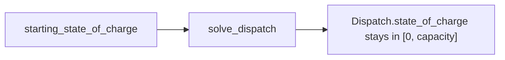

# Slice 2c: energy limits

Status: proposed (needs 2b)

## Goal
- The solver respects the battery's stored energy: the starting state of charge, empty and full.

## Seam
- `solve_dispatch`, as in 2b. No new types.

## Diagram

## Tests, in order (one red, then green, at a time)
- Fixtures and helper as in 2b: 24 hourly prices, 1 MW, 1 MWh unless stated.
- Expected values hand-derived and checked against a scratch LP.
- Every test has a docstring stating the behaviour it covers.

1. Falling prices 24..1, full battery: sells everything in the first hour; powers [+1, 0 x23].
2. Falling prices 24..1, empty battery: no spread, no trade; all zeros.
3. Starting state of charge is respected (half full, rising prices 1..24): powers [-0.5, 0 x22, +1].

## Considered and dropped
- The old negative-price "full battery does nothing" test: tied optima make it fragile.

## Deferred
- Refusing a starting charge that does not fit the battery: step 13 in the README map.

## Out of scope
- Power-limit behaviours: 2d.
