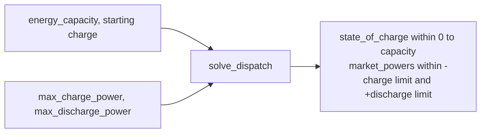

# Slice 2c: energy and power limits

Status: proposed (needs 2b)

## Goal
- The solver respects the battery's energy limits (empty, full, starting charge) and its power limits (charge and discharge, separately).
- TDD order inside the slice: the energy tests pass with only the state-of-charge bounds from 2b; the power tests go red and drive the power bounds in.

## Seam
- `solve_dispatch`, as in 2b. No new types.

## Diagram

## Tests, in order (one red, then green, at a time)
- Fixtures: 4 hourly periods (1 MW over 1 h = 1 MWh), rising prices 10, 20, 30, 40 unless stated.
- Each test states in its docstring which limit binds and which is ample.
- Expected values are literals, hand-derived and checked against a scratch LP.
- Every test has a docstring stating the behaviour it covers.

Energy limits (power ample, 2 MW):
1. Energy limit binds: empty battery, 1 MWh; charges in the cheapest period and sells in the dearest; powers `[-1, 0, 0, +1]`, state of charge `[1, 1, 1, 0]`.
2. A full battery sells first when prices fall (40, 30, 20, 10), 1 MWh: powers `[+1, 0, 0, 0]`.
3. An empty battery does nothing when prices fall: all zeros.
4. The starting charge is respected: half full (0.5 MWh), rising prices; powers `[-0.5, 0, 0, +1]`, state of charge `[1, 1, 1, 0]`.

Power limits (these go red first):
5. Power limit binds (energy ample, 100 MWh, starts full): dispatch equals the limit every period, and doubling the limit doubles it. 1 MW gives `[1, 1, 1, 1]`, state of charge `[99, 98, 97, 96]`; 2 MW gives `[2, 2, 2, 2]`, state of charge `[98, 96, 94, 92]`.
6. Both limits bind (0.5 MW, 1 MWh, starts empty): it can neither fill nor empty in one period; powers `[-0.5, -0.5, +0.5, +0.5]`, state of charge `[0.5, 1, 0.5, 0]`.
7. Charge and discharge limits are separate (2 MW charge, 1 MW discharge, 2 MWh, starts empty): powers `[-2, 0, +1, +1]`, state of charge `[2, 2, 1, 0]`.

## Considered and dropped
- The old negative-price "full battery does nothing" test: tied optima make it fragile.

## Moved to a later step
- Refusing a starting charge that does not fit the battery.

## Out of scope
- Exclusivity of charge and discharge: slice 6.
