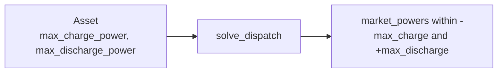

# Slice 2d: power limits

Status: proposed (needs 2b)

## Goal
- The solver respects the asset's charge and discharge power limits, applied separately.

## Seam
- `solve_dispatch`, as in 2b. No new types.

## Diagram

## Tests, in order (one red, then green, at a time)
- Fixtures and helper as in 2b: 24 hourly prices.
- Expected values hand-derived and checked against a scratch LP.
- Every test has a docstring stating the behaviour it covers.

1. Ample energy (100 MWh, starts full, 1 MW both ways), rising prices 1..24: discharges at max power every hour; powers [+1 x24], state of charge [99, 98 ... 76].
2. Charge and discharge limits are separate (2 MW charge, 1 MW discharge, 4 MWh, starts empty, rising prices 1..24): powers [-2, -2, 0 x16, +1 x4], state of charge [2, 4 x18, 3, 2, 1, 0].

## Out of scope
- Exclusivity of charge and discharge: slice 6.
