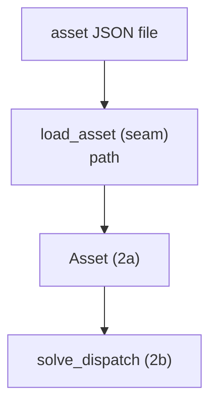

# Slice 2e: load an Asset from JSON

Status: deferred, step 14 in the README map (needs 2a); the runner passes asset values explicitly until then

## Goal
- Define the battery in a JSON file instead of code, so asset values change without editing Python.
- The solver still takes an `Asset` object; only the loader reads a file (same pattern as `load_price_series`).

## Seam
- `load_asset`, tested with small JSON files written in the test.

## Types
- `load_asset(path: str | Path) -> Asset`
- Module: `asset.py`, next to `Asset`. Uses the standard library `json`; no new dependency.

## JSON contract
- A single object whose keys are the `Asset` parameter names:
  - required: `max_charge_power` (MW), `max_discharge_power` (MW), `energy_capacity` (MWh)
  - optional, default 1.0: `charge_efficiency`, `discharge_efficiency` (fraction of energy retained)
- Values must be numbers; strings, `null` and booleans are rejected.
- Unknown keys are rejected, so a typo cannot silently fall back to a default.
- Value rules (positive limits, efficiency in (0, 1]) are enforced by `Asset`, not repeated here.
- `asset_data.xlsx` is not read. It records losses (0.05) under the name "efficiency"; the JSON takes the retained fraction (0.95), converted by hand.

## Example
```json
{
  "max_charge_power": 2,
  "max_discharge_power": 2,
  "energy_capacity": 4,
  "charge_efficiency": 0.95,
  "discharge_efficiency": 0.95
}
```

## Diagram


## Tests, in order (one red, then green, at a time)
- Every test has a docstring stating the behaviour it covers.

1. A JSON file with every field loads into an `Asset` holding those values.
2. The efficiencies are optional and default to 1.0.
3. A missing required field raises `ValueError`.
4. An unknown field raises `ValueError` (for example a misspelt `energy_capcity`).
5. A non-numeric value (string, `null`, `true`) raises `ValueError`.
6. A file that is not valid JSON, or whose top level is not an object, raises `ValueError`.

## Out of scope
- Where the runner finds the JSON, and its other settings (market files, intervals, window lengths): slice 4.
- Reading `asset_data.xlsx` and its non-dispatch fields (lifetime, capex, degradation): not planned.
