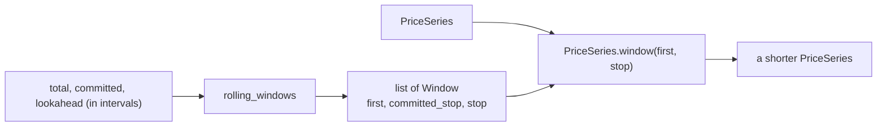

# Slice 3a: cutting windows

Status: proposed

## Goal
- Carve a long price series into overlapping windows: each window is a committed period plus a lookahead (ADR 0001).
- Pure data: no solver involved.
- The last window shrinks at the end of the series.
- The call order that uses these pieces is drawn in `slice-3b-rolling-solve.md`.

## Glossary additions (CONTEXT.md, with this slice)
- **Committed period**: the part of a foresight window whose dispatch is kept.
- **Lookahead**: the part of a foresight window beyond the committed period; it informs the committed dispatch but is discarded.

## Seams
- `rolling_windows`, tested with plain integers.
- `PriceSeries.window`, tested on a small series.

## Types
- `Window(first: int, committed_stop: int, stop: int)`: frozen dataclass of half-open interval indices; the committed part is `[first, committed_stop)`, the whole window is `[first, stop)`.
- `rolling_windows(total_intervals: int, committed_intervals: int, lookahead_intervals: int) -> list[Window]`
- `PriceSeries.window(first: int, stop: int) -> PriceSeries`: the prices in `[first, stop)`, the same market interval, and `start` moved forward by `first` intervals.
- Module for the first two: `windows.py`.

## Rule
- Window `k` has `first = k * committed`, `committed_stop = min(first + committed, total)`, `stop = min(committed_stop + lookahead, total)`.
- Windows are produced until `committed_stop` reaches `total`.

## Diagram

## Tests, in order (one red, then green, at a time)
- Expected values are literals, hand-written from the rule above.
- Every test has a docstring stating the behaviour it covers.

1. Windows tile the series: committed ranges abut and cover it exactly, each with its lookahead; the last window is shorter and its lookahead is clipped at the end of the series (10 intervals, committed 4, lookahead 2 gives `(0,4,6)`, `(4,8,10)`, `(8,10,10)`).
2. A committed period below one interval is refused with `ValueError`, since the windows would never advance.
3. A window of a price series holds the prices in its range and starts at the matching time: four hourly prices from 2018-01-01 00:00, window `[1, 3)` gives `[20, 30]` starting 01:00 with a 1 h interval.

## Considered and dropped
- Lookahead clipped at the end of the series: covered by test 1, whose last window shows it.
- No lookahead, so the windows are the committed periods: covered by the first test of 3b.
- A committed period at least as long as the series: does not happen with the real data.

## Moved to a later step
- Refusing a window that lies outside the series; slicing would otherwise clip it silently.

## Out of scope
- Turning durations into interval counts, and solving window by window: 3b.
