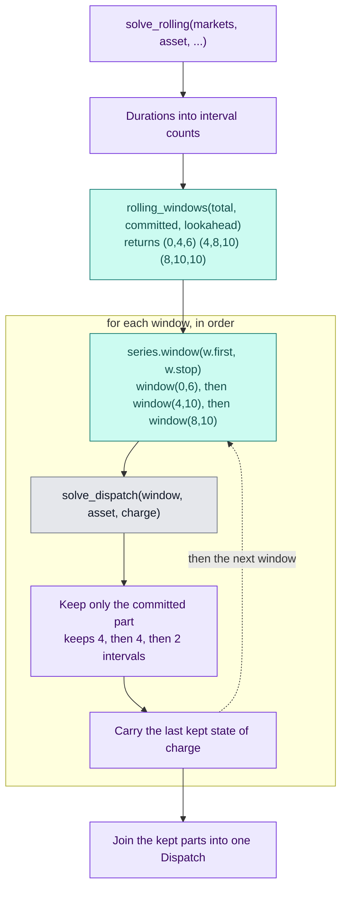

# Slice 3b: rolling solve

Status: proposed (needs 3a)

## Goal
- Solve a long series window by window, carrying the state of charge forward, and stitch the committed parts into one `Dispatch` (ADR 0001).
- A whole-series solve is the special case where the committed period is the series length and the lookahead is zero.

## Seam
- `solve_rolling`, tested through its inputs and outputs only.

## Types
- `solve_rolling(markets: Sequence[PriceSeries], asset: Asset, starting_state_of_charge: float, committed_period: timedelta, lookahead: timedelta) -> Dispatch`
- Module: `rolling.py`.
- No default periods in the function: the runner supplies 24 h and 8 h (ADR 0001) from its own settings.

## Behaviour
- Convert the committed period and lookahead into interval counts using the market interval; each must be a whole number of intervals.
- For each window from `rolling_windows`: cut the window from each market, call `solve_dispatch` with the carried state of charge, and keep only the committed intervals of market power and state of charge.
- Carry the last kept state of charge into the next window.
- Concatenate the kept parts into one `Dispatch` covering every interval.
- Windows are cut for the markets given, and `solve_dispatch` still accepts exactly one market.

## Diagram: call order
- Read top to bottom; the loop runs once per window, in order.
- Teal boxes are slice 3a, purple boxes are slice 3b, grey boxes are already built.
- Example: 10 intervals, committed 4, lookahead 2.

## Tests, in order (one red, then green, at a time)
- Fixtures: hourly prices, asset of 2 MW power and 1 MWh capacity, starting empty unless stated.
- Expected values are literals, hand-derived and checked by running the solver window by window.
- Every test has a docstring stating the behaviour it covers.

1. With no lookahead the battery trades inside each window and ignores later prices: prices 10, 20, 30, 40, committed 2 h, lookahead 0 gives powers `[-1, +1, -1, +1]`, state of charge `[1, 0, 1, 0]`.
2. With enough lookahead the answer matches the whole series, and the state of charge carries across the boundary: the same prices, committed 2 h, lookahead 2 h give `[-1, 0, 0, +1]`, state of charge `[1, 1, 1, 0]`. Without the carry the second window would restart empty and could not sell at 40.
3. The last window is shorter when the series does not divide evenly: five periods at 10 to 50, committed 2 h, lookahead 0 give `[-1, +1, -1, +1, 0]`, state of charge `[1, 0, 1, 0, 0]`, so every period has a dispatch.
4. A committed period equal to the series length is the whole-series solve: committed 4 h, lookahead 0 give `[-1, 0, 0, +1]`.
5. A committed period or lookahead that is not a whole number of market intervals is refused with `ValueError` (90 minutes on an hourly market).

## Moved to a later step
- Refusing a negative lookahead.

## Known and not addressed
- The carried state of charge is not clipped; floating-point noise stays inside the solver's tolerance.
- With zero markets the error comes from indexing the market list, not from `solve_dispatch`.

## Out of scope
- Several markets, whose windows must be a multiple of the lowest common multiple of the market intervals: the second-market slice.
- Measuring the cost of limited foresight against a whole-series solve: reporting.
